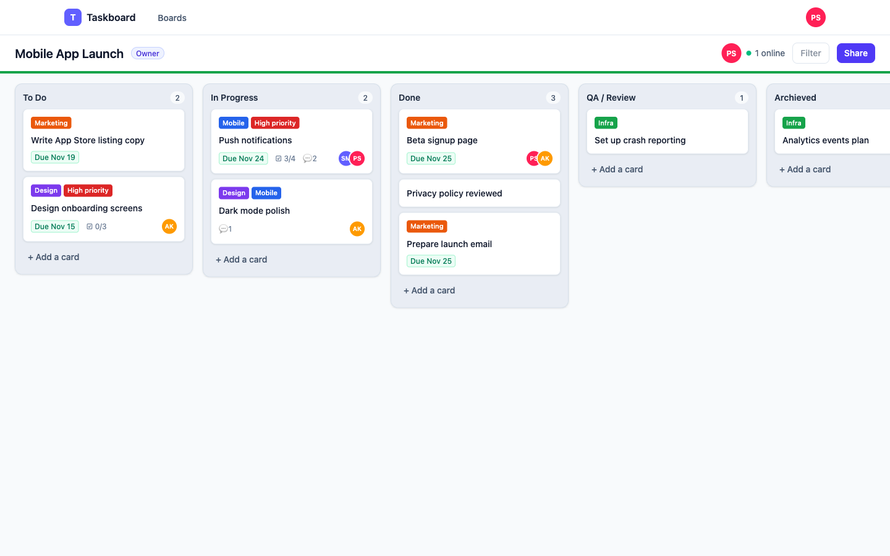
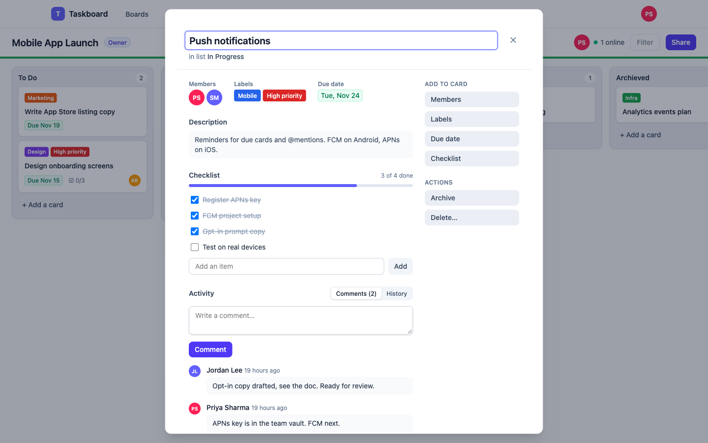
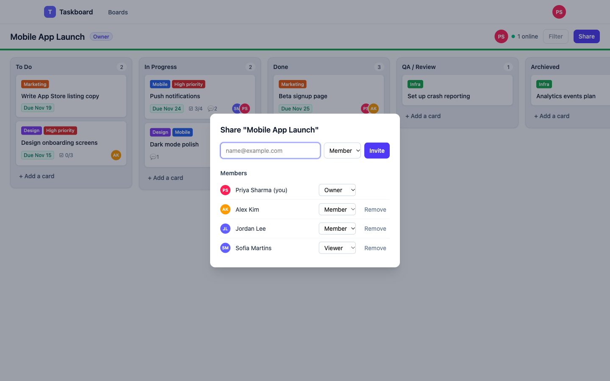
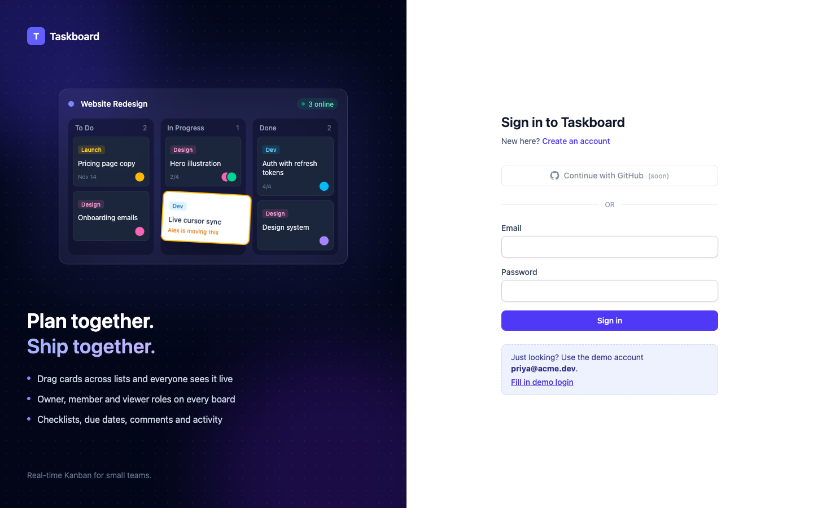
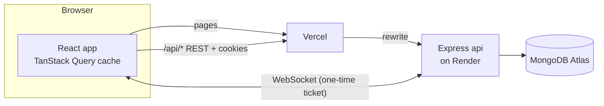

# Taskboard

A real-time collaborative Kanban board: drag a card and everyone on the board sees it move, with
presence, roles and invites.

**Live demo:** https://taskboard-murex-omega.vercel.app
Sign in with **`priya@acme.dev`** / **`demo1234!`** (or click _Fill in demo login_). Open a second
window as **`alex@acme.dev`** (same password) to watch changes sync live.

> The api runs on Render's free plan and sleeps after 15 minutes idle, so the first request can
> take 30–60 seconds.



| Card detail                                      | Share and roles                      |
| ------------------------------------------------ | ------------------------------------ |
|  |  |



## Features

- **Boards, lists and cards** with drag and drop (dnd-kit). Moves are optimistic and roll back
  with a toast if the server refuses them.
- **Live sync** over Socket.IO: card and list changes, comments and member changes reach every
  open window. Your own other tabs stay in sync too.
- **Presence:** who is online on a board, and "Alex is moving this" while someone drags a card.
- **Roles per board:** owner, member and viewer. Viewers are read-only in the UI and in the api.
- **Invites** by link, bound to the invited email, valid for 7 days, with resend and revoke. The
  last owner can't be removed or demoted.
- **Card detail:** title, description, labels, members, due date (colour-coded by how close it
  is), checklist with progress, comments and a field-level history.
- **Accounts:** register and sign in with httpOnly cookie sessions, refresh-token rotation with
  reuse detection, and sign-in and sign-out shared across tabs.

## Architecture



- **Writes go through REST; sockets only broadcast.** A service writes to MongoDB, logs the
  activity, then emits an event to the board's room. Sockets never write to the database.
- **Layering:** routes → controller → service → model. Every board-scoped route runs
  `requireAuth`, then `requireBoardRole(minRole)`, then Zod validation, so a viewer gets 403
  before a malformed body gets 400. Non-members get 404 (ADR 005).
- **Ordering** uses fractional indexing: a card move updates one document, and position
  collisions retry with a random key in the gap (ADR 007).
- **First-party cookies:** the browser only talks to the Vercel domain, which forwards `/api` to
  Render, so Safari's third-party cookie blocking doesn't apply (ADR 018). The WebSocket goes to
  Render directly and signs in with a short-lived ticket.
- **Concurrency without transactions:** every card write bumps a `version`, and clients ignore
  an older copy that arrives late (ADR 013). Multi-step writes are ordered so a crash leaves only
  unreachable data (ADR 006).

## Tech stack

| Area      | Choice                                                                      | Why                                                                                         |
| --------- | --------------------------------------------------------------------------- | ------------------------------------------------------------------------------------------- |
| Monorepo  | pnpm workspaces                                                             | One install, and the api and web share one package of Zod schemas                           |
| Shared    | Zod                                                                         | The same schema validates the request on the server and the form and response on the client |
| API       | Node 22, Express 5, Mongoose                                                | Small, well known; Express 5 forwards async errors to the error handler                     |
| Realtime  | Socket.IO                                                                   | Rooms per board, reconnects, and acknowledgements out of the box                            |
| Auth      | jose (JWT), bcryptjs, httpOnly cookies                                      | Short access token plus a rotating opaque refresh token kept as a hash (ADR 004)            |
| Web       | React 18, Vite, TypeScript, Tailwind                                        | Fast dev server and strict types end to end                                                 |
| State     | TanStack Query + Zustand                                                    | Server state with caching and optimistic updates; Zustand only for UI state (ADR 001)       |
| Forms     | React Hook Form + Zod                                                       | The shared schemas validate the forms                                                       |
| Drag/drop | dnd-kit                                                                     | Accessible (keyboard dragging), works with sortable lists                                   |
| Logging   | Pino                                                                        | Structured JSON logs, with passwords, tokens and cookies redacted                           |
| Tests     | Vitest, Supertest, React Testing Library, Playwright, mongodb-memory-server | Fast unit and api tests without a running database, plus real-browser e2e                   |
| Hosting   | Vercel (web), Render (api), MongoDB Atlas                                   | Free plans, deploys from GitHub                                                             |

## Run it locally

You need Node 22+, pnpm and Docker.

```bash
pnpm install && cp .env.example .env    # then set JWT_ACCESS_SECRET (openssl rand -base64 48)
docker compose up -d mongo              # start MongoDB
pnpm dev                                # api on :4000, web on http://localhost:5173
```

Optional: `pnpm seed` creates the demo users and boards. `docker compose up --build` runs the
whole stack as production builds (web on http://localhost:8080).

## Testing

```bash
pnpm test        # unit and integration tests: api, web and shared (733 tests)
pnpm e2e         # Playwright end-to-end tests (needs MongoDB running)
pnpm lint        # ESLint + Prettier
pnpm typecheck   # TypeScript across all packages
```

- **API:** Supertest against an in-memory MongoDB (one database per test file). An RBAC matrix
  test calls every board-scoped endpoint as owner, member, viewer, outsider and anonymous, and
  checks each status against [docs/permissions.md](docs/permissions.md). Coverage thresholds are
  enforced in CI.
- **Web:** React Testing Library with a fake socket, so live updates are tested without a server.
- **E2E:** Playwright starts its own api and web on separate ports and database (ADR 017), then
  drives real people through sign-up, boards, drag and drop, live sync between two browsers,
  viewer read-only and sign-out.

## CI/CD

- **CI** (`.github/workflows/ci.yml`, on every pull request and push to `main`): three jobs —
  `ci` (lint, typecheck, tests with coverage, build), `audit` (`pnpm audit` for production
  dependencies) and `e2e` (Playwright against a MongoDB service container).
- **Deploy** (`.github/workflows/deploy.yml`): after CI passes on `main`, it triggers Render's
  deploy hook and waits until `/health` reports the merged commit, both directly and through the
  Vercel proxy (ADR 019). Vercel deploys the web app from its Git integration.
- Dependabot keeps dependencies current; commits follow Conventional Commits (commitlint + Husky).

## Project structure

```
apps/
  api/src/
    modules/<feature>/   routes, controller, service, model, schemas and tests per feature
                         (auth, boards, lists, cards, comments, activity, invites, members, realtime)
    middleware/  lib/  config/
  web/src/
    features/<feature>/  pages, components and hooks per feature (auth, boards, board, card, sharing)
    components/  lib/  app/
packages/shared/         Zod schemas, inferred types, roles and socket event names
e2e/                     Playwright tests
docs/                    plan, progress log, permissions table, deploy guide, ADRs
```

## Architecture decisions

Each real trade-off is written up as an ADR in [docs/adr/](docs/adr/):

1. [TanStack Query for server state, Zustand for UI state](docs/adr/001-state-management.md)
2. [Pin TypeScript 6 until typescript-eslint supports 7](docs/adr/002-typescript-6.md)
3. [Shared package from source in dev, `dist` in production](docs/adr/003-shared-package-source-condition.md)
4. [Access JWT + rotating opaque refresh token in httpOnly cookies](docs/adr/004-auth-token-strategy.md)
5. [Members embedded in the board, non-members get 404](docs/adr/005-board-membership-and-access.md)
6. [No multi-document transactions; order writes so a crash is harmless](docs/adr/006-no-multi-document-transactions.md)
7. [Unique positions with randomised retry](docs/adr/007-position-collisions.md)
8. [Pin React Router 7 while on React 18](docs/adr/008-react-router-7.md)
9. [Optimistic card moves with snapshot rollback](docs/adr/009-optimistic-card-moves.md)
10. [Socket authentication with the access cookie and an Origin check](docs/adr/010-socket-authentication.md)
11. [Clients apply every board event, including their own](docs/adr/011-apply-own-socket-events.md)
12. [Presence from board-room membership](docs/adr/012-presence-from-room-membership.md)
13. [Per-item checklist writes and card versions](docs/adr/013-per-item-checklist-writes.md)
14. [Cursor pagination by `_id`, and a stored comment count](docs/adr/014-cursor-pagination-by-id.md)
15. [Email-bound invite links, and keeping at least one owner](docs/adr/015-invites-and-last-owner.md)
16. [Disconnect a session's sockets when it is revoked](docs/adr/016-session-scoped-socket-disconnects.md)
17. [E2E tests on their own servers and database](docs/adr/017-e2e-own-servers-and-database.md)
18. [Serve the api through Vercel so login cookies are first-party](docs/adr/018-vercel-proxy-for-first-party-cookies.md)
19. [Deploy after CI and wait for the merged commit](docs/adr/019-deploy-waits-for-the-commit.md)
20. [Keep the session in sync across tabs with BroadcastChannel](docs/adr/020-cross-tab-session-sync.md)

## What I would do next

- **Scale out the realtime server:** a Redis adapter for Socket.IO so more than one api instance
  can serve a board, with `serverSideEmit` for membership changes (noted in ADR 015).
- **Limits and pagination:** caps on lists and cards per board, pagination for `GET /boards`, and
  rebalancing for position keys that grow after many splits of one gap.
- **More features:** board filters (the button is already there), list drag-reorder (the api
  supports it), GitHub sign-in, email invites from a verified domain, and "leave board".
- **Sessions:** an absolute session lifetime on top of the sliding 7-day refresh, and "sign out
  everywhere".
