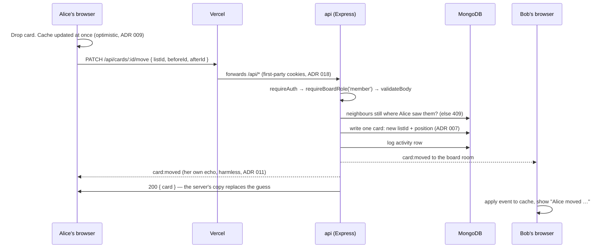

# Architecture in 5 minutes

A short tour for anyone new to the code, and a cheat sheet for interviews. The system diagram is
in the [README](../README.md#architecture), the long plain-English explanation is in
[PROJECT-GUIDE.md](PROJECT-GUIDE.md), and the reasons behind each choice are in [adr/](adr/).

## 1. The app in one paragraph

Taskboard is a collaborative Kanban board (a small Trello). A React app on Vercel talks to an
Express api on Render, which stores everything in MongoDB. People who share a board see each
other's changes live through Socket.IO. All writes go through REST; sockets only carry the news
of a write that already happened. Access is per board, with three roles: viewer < member < owner.

## 2. Where the code lives

| Folder            | What it holds                                                                                                                        |
| ----------------- | ------------------------------------------------------------------------------------------------------------------------------------ |
| `packages/shared` | Zod schemas and types used by both sides: request bodies, responses, socket events, roles. Change a shape here and both apps follow. |
| `apps/api`        | One folder per feature in `src/modules/<feature>/`: `routes → controller → service → model`, with tests next to each file.           |
| `apps/web`        | One folder per screen or feature in `src/features/<feature>/`: pages, components and the `api.ts` hooks that call the api.           |
| `e2e`             | Playwright tests that drive the real app in a browser, on their own ports and database (ADR 017).                                    |

## 3. Life of a request: moving a card

This one flow uses almost every part of the system.

If the api refuses (a 409 because someone else changed the list, or a 403 for a viewer), Alice's
browser puts the old board back and shows a toast.

## 4. Ten rules the code follows

1. **Layers:** routes → controller → service → model. Controllers never touch Mongoose; services
   hold the business rules.
2. **Every board route checks the role first:** `requireAuth`, then `requireBoardRole(minRole)`,
   then Zod validation. A viewer gets 403 before a bad body gets 400. A non-member gets **404**,
   so they can't even tell the board exists (ADR 005).
3. **Validate everything with Zod:** bodies, params, query strings, env vars, and api responses
   in the browser.
4. **Write, then log, then broadcast.** A service saves to MongoDB, records an activity row, then
   emits to the board's room (`recordWrite` does the last two). Logging and broadcasting never
   throw: the write is already saved.
5. **Sockets never write.** They join rooms, receive events, and send drag cues and presence,
   which are never saved (ADR 010, 012).
6. **A move rewrites one document.** Order is a fractional-index string, unique per list. If the
   client's view is stale, the api answers 409 and the client refetches (ADR 007).
7. **No transactions.** Multi-step writes are ordered so a crash leaves only harmless leftovers:
   delete a board before its children, a list's cards before the list (ADR 006).
8. **Newer wins on the client.** Every card write bumps `version`, and the browser ignores an
   older copy that arrives late (ADR 013).
9. **Server data lives in TanStack Query, UI state in Zustand.** Never copy api data into Zustand
   (ADR 001).
10. **Errors have one shape:** throw an `AppError` subclass (`NotFound`, `Forbidden`, …) and the
    error handler answers `{ error: { code, message, details? } }`.

## 5. Security in brief

- **Login:** a 15-minute access token and a 7-day refresh token, both in httpOnly cookies that
  JavaScript can't read. Each refresh replaces the refresh token; reusing an old one revokes the
  whole session and disconnects its sockets (ADR 004, 016).
- **Cookies stay first-party:** the browser only talks to the Vercel domain, which forwards
  `/api` to Render. The socket goes to Render directly and signs in with a one-time ticket
  (ADR 018).
- **CSRF:** `SameSite=Lax` cookies plus an Origin check on every write and socket handshake.
- **Secrets are stored as hashes:** refresh tokens, socket tickets and invite links are kept only
  as SHA-256; passwords as bcrypt. Logs redact passwords, tokens and cookies.
- **Rate limits** on login, register, refresh, invites, socket tickets and socket messages.

## 6. Adding a new write endpoint: checklist

1. Request and response schemas in `packages/shared`.
2. Route with `requireAuth` → `requireBoardRole(minRole)` → `validateBody(schema)`.
3. Controller reads `getBoardContext(req)` and calls the service.
4. Service writes (with `$inc: { version: 1 }` if it's a card), then `recordWrite(...)`.
5. Event schema in `boardEventSchemas` (`packages/shared/src/realtime.ts`), and handle it in
   `applyBoardEvent` on the web.
6. Tests: a row in `docs/permissions.md` and in `ENDPOINTS` in `apps/api/src/rbac.test.ts`, a row
   in the `writes` table in `modules/realtime/realtime.test.ts`, plus the feature's own tests.

## 7. Known limits

- No caps on lists or cards per board, and `GET /boards` isn't paged.
- One api instance. A second one would need the Socket.IO Redis adapter (ADR 012, 015).
- A socket's `board:join` that times out is only retried on the next reconnect.
- Two simultaneous archives of the same card both log "archived".

## 8. Reading the ADRs

Start with **004, 005, 006, 007 and 011**: together they explain most of the design. Then read
by topic: realtime (010–014), sharing (015), deployment (017–019). Read the Decision and
Consequences sections first. Watch the status lines: ADR 010's cookie handshake was replaced by
ADR 018's tickets.
