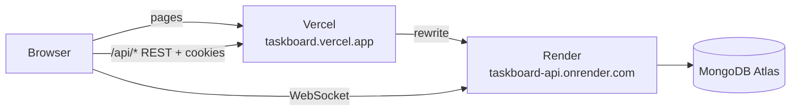

# Deploying Taskboard

Production runs on three free services. The browser only ever talks to the web app's own
address: Vercel forwards `/api/*` to the api, so the login cookies are first-party in every
browser (ADR 018). The live connection is the one exception: Vercel can't proxy WebSockets, so
the socket connects to Render directly.

## 1. MongoDB Atlas

1. Create a free (M0) cluster, close to the Render region (`oregon` in `render.yaml`).
2. **Database Access:** add a user with a long random password and the `readWrite` role on the
   `taskboard` database.
3. **Network Access:** allow `0.0.0.0/0`. Render's free plan has no fixed outbound IP, so the
   database is protected by its password alone. Use a password nothing else uses.
4. Copy the connection string (`mongodb+srv://…`) and add the database name:
   `mongodb+srv://<user>:<password>@<cluster>/taskboard?retryWrites=true&w=majority`.

## 2. Render (api)

1. **New → Blueprint**, pick this repository. Render reads `render.yaml` and creates the
   `taskboard-api` service from `apps/api/Dockerfile`.
2. Fill in the values it asks for (table below). `JWT_ACCESS_SECRET` is generated by Render.
3. Note the service URL. If the name `taskboard-api` was taken, the URL differs: update the
   rewrite destination in `apps/web/vercel.json` and `VITE_SOCKET_URL` on Vercel to match.
4. Deploys are not automatic (`autoDeployTrigger: off`); Slice 7.2 triggers them after CI.

| Variable            | Value                                                          | Where it comes from |
| ------------------- | -------------------------------------------------------------- | ------------------- |
| `NODE_ENV`          | `production`                                                   | `render.yaml`       |
| `PORT`              | `10000`                                                        | `render.yaml`       |
| `LOG_LEVEL`         | `info`                                                         | `render.yaml`       |
| `CLIENT_URL`        | The Vercel production URL, e.g. `https://taskboard.vercel.app` | you, once           |
| `MONGODB_URI`       | The Atlas connection string                                    | you, once           |
| `JWT_ACCESS_SECRET` | 256-bit random, base64                                         | generated by Render |
| `API_PUBLIC_PATH`   | `/api` (scopes the refresh cookie to `/api/auth`)              | `render.yaml`       |
| `TRUST_PROXY`       | `2` (Vercel + Render's proxy), confirmed after deploy          | `render.yaml`       |
| `COOKIE_SECURE`     | not set: defaults to `true` in production                      | —                   |
| `RESEND_API_KEY`    | optional, invite emails (needs a verified domain)              | dashboard           |
| `EMAIL_FROM`        | optional, set together with `RESEND_API_KEY`                   | dashboard           |

The api refuses to start if a required value is missing or malformed (Zod, `config/env.ts`),
and exits if it can't reach the database.

## 3. Vercel (web)

1. **Add New → Project**, import this repository.
2. **Root Directory:** `apps/web`. Framework preset: Vite. `apps/web/vercel.json` sets the
   install, build and output settings, the `/api` rewrite, and the single-page-app fallback.
3. **Node.js version:** 22.x (Project Settings → Build and Deployment).
4. **Environment variables** (Production):

| Variable                       | Value                                | Why                                                  |
| ------------------------------ | ------------------------------------ | ---------------------------------------------------- |
| `VITE_API_URL`                 | `/api`                               | REST goes through Vercel's rewrite (first-party)     |
| `VITE_SOCKET_URL`              | `https://taskboard-api.onrender.com` | WebSockets go to Render directly                     |
| `ENABLE_EXPERIMENTAL_COREPACK` | `1`                                  | Installs the pnpm version pinned in `packageManager` |

`VITE_*` values are baked into the bundle at build time: redeploy after changing them.

## 4. After the first deploy (Slice 7.2)

- `https://<render-url>/health` returns `{"status":"ok","db":"connected"}`.
- In the browser: sign in, reload a board page (the SPA fallback), and check in DevTools that
  `tb_refresh` has `Path=/api/auth`, `Secure`, `SameSite=Lax`.
- Confirm `TRUST_PROXY`: log `req.ip` once and check it is your own address, not Vercel's.
- Seed the demo data against Atlas (`pnpm seed` with the Atlas `MONGODB_URI`).

## Known limits

- **Cold starts:** Render's free plan sleeps after 15 minutes idle; the first request can take
  30–60 s. Vercel's proxy may time out on it, and a retry succeeds.
- **Preview deployments** on Vercel have their own URLs, which `CLIENT_URL` doesn't allow, so
  only the production URL works.
- **Live updates** need the socket tickets of Slice 7.1b: the socket can't send the login cookie
  to Render, which is a different site.
- **Direct calls to Render** skip Vercel. With `TRUST_PROXY=2` such a caller could fake its IP for
  the rate limits; restricting the origin to Vercel traffic with a secret header is a follow-up.
