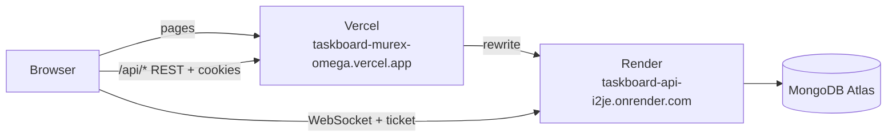

# Deploying Taskboard

A step-by-step guide to putting Taskboard online for free, plus the reference tables behind it.
Work through the steps in order and tick each box. It takes about an hour the first time.

**Never paste passwords, connection strings or secrets into chat, issues or commits.** They only
go into the Atlas, Render and Vercel dashboards (and your local terminal for the seed).

## How the pieces fit

The browser only ever talks to the web app's own address. Vercel forwards `/api/*` to the api,
so the login cookies are first-party in every browser, Safari included (ADR 018). The live
connection is the one exception: Vercel can't forward WebSockets, so the socket connects to
Render directly and logs in with a one-time ticket.

**Live deployment:** web `https://taskboard-murex-omega.vercel.app`, api
`https://taskboard-api-i2je.onrender.com` (Render added `-i2je` because `taskboard-api` was taken).



| Service       | Hosts                                   | Free plan limits that matter                          |
| ------------- | --------------------------------------- | ----------------------------------------------------- |
| MongoDB Atlas | The database                            | 512 MB storage, shared cluster                        |
| Render        | The api (`apps/api`, Docker)            | Sleeps after 15 min idle; first request takes 30–60 s |
| Vercel        | The web app (`apps/web`), and the proxy | Hobby plan, non-commercial use                        |

---

## Step 0 — Before you start

- [ ] **Accounts.** Create free accounts on [MongoDB Atlas](https://www.mongodb.com/cloud/atlas),
      [Render](https://render.com) and [Vercel](https://vercel.com). Sign up to Render and
      Vercel **with GitHub**, so they can read the repository.
- [ ] **Merge the deploy config into `main`.** Render and Vercel deploy from `main`, and they
      need `render.yaml` and `apps/web/vercel.json` from the `chore/deploy` branch.
- [ ] **Pick two names** and write them down:
  - the **Vercel project name** → your site will be `https://<project>.vercel.app`
    (for example `taskboard` → `https://taskboard.vercel.app`, if the name is free);
  - the **Render service name** is `taskboard-api` (from `render.yaml`) → the api will be
    `https://taskboard-api.onrender.com` only if nobody has that name. Otherwise Render adds a
    suffix (ours is `https://taskboard-api-i2je.onrender.com`), and Step 4 is required.
- [ ] **Locally:** the repository is checked out on `main`, `pnpm install` has run, and the root
      `.env` exists (the seed in Step 5 reads `JWT_ACCESS_SECRET` from it).

## Step 1 — MongoDB Atlas (the database)

- [ ] **Create a cluster:** _Create_ → **M0 (Free)**. Provider and region: pick the one closest
      to Render's region, which is **Oregon (US West)** in `render.yaml` (for example AWS
      `us-west-2`). Name it `taskboard`.
- [ ] **Create a database user** (Security → Database Access):
  - username `taskboard-api`;
  - **autogenerate a password** and keep it in your password manager;
  - role: _Read and write to any database_ is fine for a free demo cluster.
- [ ] **Allow network access** (Security → Network Access): _Add IP address_ →
      **Allow access from anywhere** (`0.0.0.0/0`). Render's free plan has no fixed address, so
      the password is the database's only protection. Don't reuse it anywhere.
- [ ] **Copy the connection string:** cluster → _Connect_ → _Drivers_ (Node.js). It looks like
      `mongodb+srv://taskboard-api:<password>@taskboard.abc12.mongodb.net/?retryWrites=true&w=majority`.
- [ ] **Add the database name** right after `.net/`, and put in the password:

  ```text
  mongodb+srv://taskboard-api:<password>@taskboard.abc12.mongodb.net/taskboard?retryWrites=true&w=majority
  ```

  This full string is your **`MONGODB_URI`**. If the password contains `@ : / ? # %`,
  percent-encode those characters, or generate a password without them.

## Step 2 — Vercel (the web app)

Vercel goes first because the api needs to know the site's address.

- [ ] _Add New_ → _Project_ → import the `taskboard` repository.
- [ ] **Project name:** the name from Step 0 (it decides the `.vercel.app` address).
- [ ] **Root Directory:** click _Edit_ and choose **`apps/web`**. Leave _Include files outside the
      root directory_ on (the default): the build needs `packages/shared`.
- [ ] **Framework preset:** Vite. Leave build and install commands empty: `apps/web/vercel.json`
      sets them (`pnpm install --frozen-lockfile`, `pnpm build`, output `dist`).
- [ ] **Environment variables** (all three, environment _Production_):

  | Name                           | Value                                                                        |
  | ------------------------------ | ---------------------------------------------------------------------------- |
  | `VITE_API_URL`                 | `/api`                                                                       |
  | `VITE_SOCKET_URL`              | the Render URL from Step 3 (ours: `https://taskboard-api-i2je.onrender.com`) |
  | `ENABLE_EXPERIMENTAL_COREPACK` | `1`                                                                          |

  The last one makes Vercel use the pnpm version pinned in `package.json` (`pnpm@12.15.0`).

- [ ] _Deploy_. When it's done, open the site: the sign-in page should show. **Signing in fails
      for now** (the api doesn't exist yet). That's expected.
- [ ] **Node.js version:** Project → _Settings_ → _Build and Deployment_ → Node.js **22.x**. If you
      changed it, redeploy (_Deployments_ → latest → _Redeploy_).
- [ ] **Copy the production address** from the project's _Domains_ (for example
      `https://taskboard.vercel.app`). This is your **`CLIENT_URL`**. Use exactly this, with
      `https://` and no path.

## Step 3 — Render (the api)

- [ ] _New_ → **Blueprint** → connect the `taskboard` repository, branch `main`. Render reads
      `render.yaml` and shows one service, **`taskboard-api`** (Docker, free plan).
- [ ] Fill in the two values it asks for:
  - **`CLIENT_URL`**: the Vercel address from Step 2;
  - **`MONGODB_URI`**: the Atlas string from Step 1.

  `JWT_ACCESS_SECRET` is generated by Render; the rest comes from `render.yaml`.

- [ ] _Apply_ / _Deploy Blueprint_. The first build takes a few minutes (it builds
      `apps/api/Dockerfile`).
- [ ] **Check the logs** (service → _Logs_): you should see `mongodb connected` and
      `api listening`. If you see `Invalid environment variables`, the message names the value to
      fix (Environment tab, then _Manual Deploy_).
- [ ] **Check the health URL** in the browser: `https://<render-url>/health`
      returns `{"status":"ok","db":"connected"}`.
- [ ] **Write down the service URL** shown at the top of the service page.

> Auto-deploy is off (`autoDeployTrigger: off`). Until Slice 7.2 automates it, deploy a new
> version with _Manual Deploy_ → _Deploy latest commit_.

## Step 4 — Connect the two (only if the Render URL differs)

Skip this step if the Render URL is exactly `https://taskboard-api.onrender.com`.

If the name was taken, Render gives a different address (ours is
`https://taskboard-api-i2je.onrender.com`). **Don't skip this:** the old name belongs to someone
else's service, so until the rewrite changes, Vercel forwards every sign-in (email and password
included) to a stranger's server. That shows up as an HTML `Cannot POST /auth/login` 404 instead
of the api's JSON errors.

- [ ] In `apps/web/vercel.json`, change the rewrite destination to the real address
      (`"destination": "https://taskboard-api-i2je.onrender.com/:path*"`), commit and merge to
      `main`.
- [ ] In Vercel, set `VITE_SOCKET_URL` to the same address.
- [ ] Deploy the **new commit** on Vercel: _Deployments_ → _Create Deployment_ → `main`. Don't use
      _Redeploy_ on an older deployment: it rebuilds **that deployment's commit** (with the current
      env vars), so the old rewrite stays. Check that the new deployment's _Source_ shows the merge
      commit and that it is marked _Production_.
- [ ] Check the proxy: `curl -i https://<vercel-url>/api/health` returns
      `{"status":"ok","db":"connected"}`. An HTML `Cannot GET /health` means the rewrite still
      points at the wrong service (a header `x-powered-by: Express` gives it away; our api never
      sends it).

## Step 5 — Demo data

The sign-in page offers a demo account, so the production database needs it. Run the seed from
your machine against Atlas:

```bash
MONGODB_URI='<your Atlas MONGODB_URI>' pnpm seed
```

- [ ] It ends with `demo ready: sign in as priya@acme.dev or alex@acme.dev`.

Use single quotes so the shell leaves the password alone, and don't save the command in a file.
The variable set on the command line wins over the one in `.env`, so your local database isn't
touched.

## Step 6 — Check that it works

Use a **private/incognito window**, and try **Safari or Firefox** too (that's what ADR 018 is
for).

- [ ] Open the Vercel address. (If the api was asleep, the first sign-in can time out: wait 30 s
      and try again.)
- [ ] _Fill in demo login_ → _Sign in_ → you see My boards with **Website Redesign**.
- [ ] Open the board, then **reload the page**: it stays on the board (the SPA fallback works).
- [ ] Drag a card to another list and reload: it stayed there.
- [ ] **Live updates:** sign in as `alex@acme.dev` (password `demo1234!`) in a second browser,
      open the same board: both show **2 online**, and a card moved in one window moves in the
      other.
- [ ] **Cookies** (DevTools → Application → Cookies, on the Vercel address): `tb_access` with
      `Path=/`, `tb_refresh` with `Path=/api/auth`; both `HttpOnly`, `Secure`, `SameSite=Lax`.
- [ ] **Sign out** in one tab: the other tab goes to the sign-in page by itself.

Then tell me the results; we confirm `TRUST_PROXY` together in Slice 7.2.

## Troubleshooting

| What you see                                                       | Likely cause and fix                                                                                                                                                        |
| ------------------------------------------------------------------ | --------------------------------------------------------------------------------------------------------------------------------------------------------------------------- |
| Vercel build fails at install, mentioning pnpm or `packageManager` | `ENABLE_EXPERIMENTAL_COREPACK=1` is missing, or Node isn't 22.x. Fix and redeploy.                                                                                          |
| Vercel build can't find `@taskboard/shared`                        | _Include files outside the root directory_ is off. Turn it on (Settings → Build and Deployment).                                                                            |
| Reloading `/b/...` shows Vercel's 404                              | `apps/web/vercel.json` isn't in the deployed commit, or the Root Directory isn't `apps/web`.                                                                                |
| Sign-in shows "Something went wrong", api logs show nothing        | The rewrite points at the wrong Render address (Step 4), or the api is still waking up.                                                                                     |
| Sign-in fails with an HTML 404 `Cannot POST /auth/login`           | The live build has an old rewrite pointing at someone else's service. Fix `vercel.json`, then _Create Deployment_ from `main` (not _Redeploy_), Step 4.                     |
| Demo sign-in says "Invalid email or password"                      | The production database has no demo users yet. Run the seed (Step 5).                                                                                                       |
| Sign-in fails with 403                                             | `CLIENT_URL` on Render doesn't match the address in the browser exactly (`https://`, no path). Fix it and _Manual Deploy_.                                                  |
| Signed in, but every later page says you're signed out             | The refresh cookie's path is wrong: `API_PUBLIC_PATH` must be `/api` on Render.                                                                                             |
| Everything works except live updates (no "online" count)           | `VITE_SOCKET_URL` is wrong or missing (redeploy Vercel after fixing; `VITE_*` values are baked in at build time), or `CLIENT_URL` doesn't match (the socket checks it too). |
| Render logs: `Invalid environment variables`                       | The message names the variable. Fix it in Render → Environment, then _Manual Deploy_.                                                                                       |
| Render logs: `could not connect to mongodb`                        | Wrong `MONGODB_URI` (password, missing `/taskboard`), or Atlas Network Access doesn't allow `0.0.0.0/0`.                                                                    |
| The first request after a while takes long or fails                | Render's free plan was asleep. It wakes within a minute; try again.                                                                                                         |

---

## Reference

### Render environment variables (api)

| Variable            | Value                                                          | Set by              |
| ------------------- | -------------------------------------------------------------- | ------------------- |
| `NODE_ENV`          | `production`                                                   | `render.yaml`       |
| `PORT`              | `10000`                                                        | `render.yaml`       |
| `LOG_LEVEL`         | `info`                                                         | `render.yaml`       |
| `CLIENT_URL`        | The Vercel production URL, e.g. `https://taskboard.vercel.app` | you, once           |
| `MONGODB_URI`       | The Atlas connection string, with `/taskboard`                 | you, once           |
| `JWT_ACCESS_SECRET` | 256-bit random, base64                                         | generated by Render |
| `API_PUBLIC_PATH`   | `/api` (scopes the refresh cookie to `/api/auth`)              | `render.yaml`       |
| `TRUST_PROXY`       | `2` (Vercel + Render's proxy), confirmed in Slice 7.2          | `render.yaml`       |
| `COOKIE_SECURE`     | not set: defaults to `true` in production                      | —                   |
| `RESEND_API_KEY`    | optional, invite emails (needs a verified domain)              | dashboard           |
| `EMAIL_FROM`        | optional, set together with `RESEND_API_KEY`                   | dashboard           |

The api refuses to start if a required value is missing or malformed (Zod, `config/env.ts`),
and exits if it can't reach the database.

### Vercel environment variables (web)

| Variable                       | Value                                     | Why                                                  |
| ------------------------------ | ----------------------------------------- | ---------------------------------------------------- |
| `VITE_API_URL`                 | `/api`                                    | REST goes through Vercel's rewrite (first-party)     |
| `VITE_SOCKET_URL`              | `https://taskboard-api-i2je.onrender.com` | WebSockets go to Render directly                     |
| `ENABLE_EXPERIMENTAL_COREPACK` | `1`                                       | Installs the pnpm version pinned in `packageManager` |

`VITE_*` values are baked into the bundle at build time: deploy again after changing them.
_Redeploy_ is enough for an env change; a `vercel.json` change needs a deployment of the new
commit (_Create Deployment_ → `main`).

### Known limits

- **Cold starts:** Render's free plan sleeps after 15 minutes idle; the first request can take
  30–60 s. Vercel's proxy may time out on it, and a retry succeeds.
- **Preview deployments** on Vercel have their own URLs, which `CLIENT_URL` doesn't allow, so
  only the production URL works.
- **Direct calls to Render** skip Vercel. With `TRUST_PROXY=2` such a caller could fake its IP for
  the rate limits; restricting the origin to Vercel traffic with a secret header is a follow-up.
- **Invite emails** need Resend with a verified domain. Without one, owners copy the invite link
  from the Share dialog (ADR 015).
